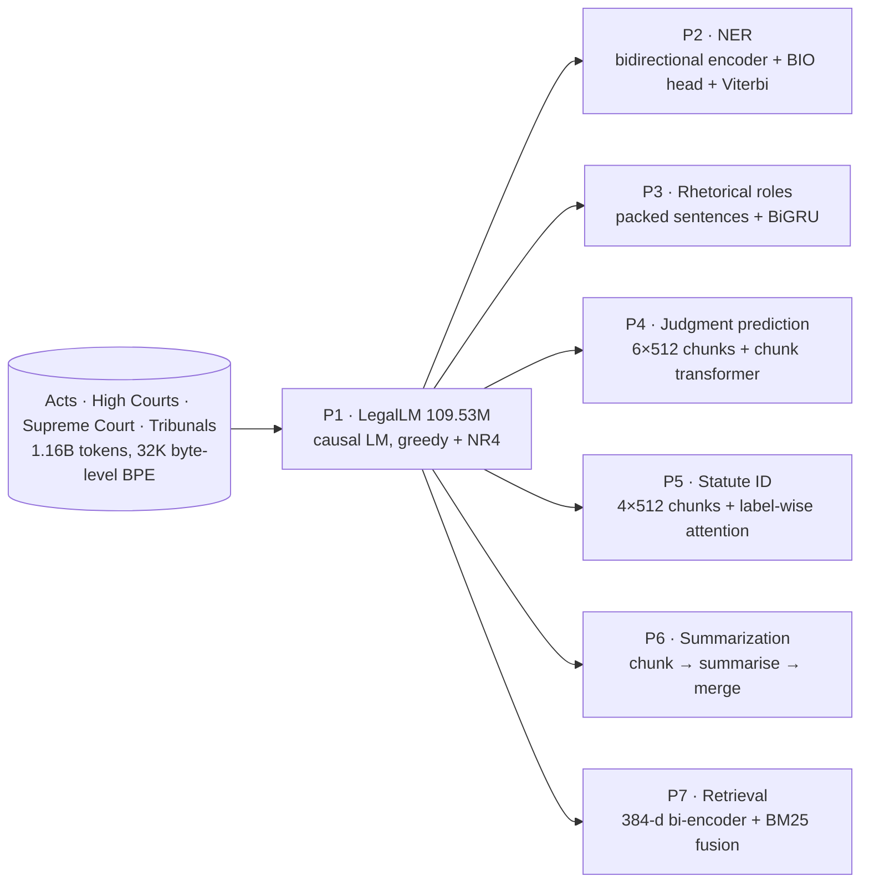

# CS781 Capstone: In-House Legal Intelligence System

A self-hostable, seven-phase legal NLP stack built on **LegalLM**, a 109.53M-parameter decoder trained **from scratch** on 1.16B tokens of Indian court, Act and tribunal text. Every downstream model (NER, rhetorical roles, judgment prediction, statute identification, summarization, prior-case retrieval) is a fine-tuned descendant of the same checkpoint. Nothing calls an external API or a pretrained LM.

**Adyansu Beura** (230086), IIT Kanpur · Codabench `a_230086` · Full report: [`docs/CS781-CP-Adyansu-Beura-230086-report.pdf`](docs/CS781-CP-Adyansu-Beura-230086-report.pdf)

## Results

Best valid Codabench submission per phase and leaderboard rank, recorded 9 November 2026. In total there were 54 valid submissions, and every phase had at least the required four.

| Phase | Task | Metric | Score | Rank | Valid subs | Final system |
|---|---|---|---|---|---|---|
| 1 | Legal LM pretraining | BERTScore-F1 | **0.8458** | 6 | 5 | LegalLM, greedy + 4-gram no-repeat |
| 2 | Legal NER | Strict span macro-F1 | **0.5714** | 32 | 11 | LoRMA + 256-token header context + weighted CE |
| 3 | Rhetorical role prediction | Macro-F1 | **0.5273** | 40 | 10 | Contextual encoder + BiGRU, LoRMA |
| 4 | Court judgment prediction | Macro-F1 | **0.6204** | 117 | 6 | Hierarchical chunk model, ensemble |
| 5 | Legal statute identification | Macro-F1 | **0.4307** | 19 | 6 | Label-wise attention, full FT, per-label τ |
| 6 | Abstractive summarization | BERTScore-F1 | **0.8522** | 14 | 8 | Chunk-and-merge, full FT, greedy + 3-gram block |
| 7 | Prior case retrieval | Micro-F1@7 | **0.3887** | 67 | 8 | Dense bi-encoder (full FT) + n-gram BM25 |

## Contents

- [Repository layout](#repository-layout)
- [Setup](#setup)
- [System overview](#system-overview)
- [Phase 1: Legal LM pretraining](#phase-1-legal-lm-pretraining)
- [Shared downstream machinery](#shared-downstream-machinery)
- [Phase 2: Legal NER](#phase-2-legal-named-entity-recognition)
- [Phase 3: Rhetorical roles](#phase-3-rhetorical-role-prediction)
- [Phase 4: Judgment prediction](#phase-4-court-judgment-prediction-cjpe)
- [Phase 5: Statute identification](#phase-5-legal-statute-identification-lsi)
- [Phase 6: Summarization](#phase-6-abstractive-summarization)
- [Phase 7: Prior case retrieval](#phase-7-prior-case-retrieval-pcr)
- [What mattered](#what-mattered-and-what-did-not)
- [Limitations](#limitations)
- [References](#references)

## Repository layout

```
├── backbones/                        # the five Phase-1 families behind one interface
│   ├── __init__.py                   #   build_backbone / load_backbone / encode / count_parameters
│   ├── legallm.py                    #   re-exports phase1_pretraining/legallm/model.py (the submitted model)
│   ├── gpt2_baseline.py              #   GPT-2-style decoder baseline (59.46M)
│   ├── encdec_hybrid.py              #   encoder-decoder prefix-LM (123.69M)
│   ├── swa_lite.py                   #   sliding-window lightweight decoder (57.29M)
│   ├── jurisnet.py                   #   citation-aware JurisNetLM (109.53M)
│   └── citations.py                  #   rule-based case-citation / statute tagger used by JurisNetLM
├── phase1_pretraining/
│   ├── legallm/                      # submitted model: model.py, train.py, config.json, train_config.json, tokenizer.json
│   ├── configs/                      # pretraining configs for every family (legallm, gpt2_baseline, swa_lite, jurisnet, encdec_hybrid)
│   ├── prepare_data.py               # tokenizer training + streamed corpus -> uint16 memmaps (+ citation types, eval pairs)
│   ├── pretrain.py                   # time-budgeted DDP pretraining for any family
│   ├── generate.py                   # decoding (greedy / repetition penalty / n-gram block / beam) -> submission.zip
│   └── notebooks/phase1_legallm_v2.ipynb   # continued training + decoding search (Kaggle)
├── phase2_legal_ner/phase2_lner.ipynb
├── phase3_rhetorical_roles/          # rr_data.py (format detection), rr_train.py (model + training), phase3_rr.ipynb
├── phase4_judgment_prediction/phase4_cjpe.ipynb
├── phase5_statute_identification/phase5_lsi.ipynb
├── phase6_summarization/phase6_summ.ipynb
├── phase7_prior_case_retrieval/phase7_pcr.ipynb
├── tests/smoke_test.py, tests/e2e_cpu.sh   # CPU checks for the backbone code and the Phase-1 tooling
└── docs/                             # final report (PDF)
```

Each phase folder has a short README with run instructions. The notebooks keep their Kaggle outputs, so the training logs behind the local numbers below are visible in them.

## Setup

```bash
pip install -r requirements.txt
export HF_TOKEN=...                       # access to the gated course dataset Exploration-Lab/CS-781-Capstone
python tests/smoke_test.py                # ~1 min on CPU: parameter counts, losses, KV cache, PEFT compatibility
bash tests/e2e_cpu.sh                     # ~2 min on CPU: data prep -> pretraining -> decoding for every family
```

- **Hardware.** Every run used Kaggle with 2× Tesla T4 (16 GB), fp16 autocast and AdamW. The T4 has no bf16 support. Runs checkpoint so they can resume across the 12-hour Kaggle session limit.
- **Notebooks** (phases 1–7) search `/kaggle/input` for their inputs. They need the phase data, the Phase-1 model folder (`config.json`, `pytorch_model.bin`, `tokenizer.json`, `model.py`) and, where used, the official `evaluate_phase*.py`. The Phase-1 and Phase-2 notebooks fall back to downloading from Hugging Face with the Kaggle secret `capstoned`.
- **Capstone constraints.** The foundation model must have 50M–300M parameters, be trained from scratch, and use no external legal corpora or pretrained language models. `pretrain.py` asserts the size bound.
- **Weights are not tracked in git.** `pytorch_model.bin` is ≈440 MB. The repo ships the LegalLM code, config and tokenizer; attach the exported `legal-lm-final/` folder to the downstream notebooks as a Kaggle dataset.

## System overview



The phases are trained independently, so no phase consumes another phase's predictions. The four alternative backbones were trained with the same pipeline and fine-tuned with the same task heads. None of them beat LegalLM in any phase.

---

## Phase 1: Legal LM pretraining

**Task.** Continue a legal prompt; the test set has 1,000 prompts (mean 635, max 967 GPT-2 tokens). A submission is a 128-word continuation per prompt, scored by BERTScore-F1 (roberta-large) against the true continuation.

### Data and tokenizer

| | |
|---|---|
| Sources | `train_acts.json` (729 MB), `train_high_courts.json` (10.7 GB), `train_supreme_court.json` (1.32 GB), `train_tribunals.json` (≈0.9 GB) |
| Streaming | `ijson`, document by document; no file is ever loaded whole |
| Held-out split | Per-document random draw with seed 42: 5% of Supreme Court documents and 1% of the others. The same split is used in every run and is never trained on. |
| Preprocessing | None. Case, punctuation, section symbols, citations and party names are kept because they carry meaning. |
| Tokenizer | 32,000-token byte-level BPE trained on the corpus. `<|endoftext|>` has id 0 and separates documents. There is no normaliser, and the ByteLevel pre-tokenizer runs without a prefix space. The corpus averages ≈1.33 tokens per word. |
| Token pool | uint16 memmaps; training samples random 1,024-token windows. |

`prepare_data.py` reproduces this pipeline. It trains the tokenizer, applies per-source token caps, writes the memmaps, optionally writes citation-type memmaps for JurisNetLM, and draws held-out `(prompt, next 128 words)` evaluation pairs from judgments only.

### LegalLM architecture (submitted backbone)

A Llama-style 12-layer decoder, written from scratch in [`phase1_pretraining/legallm/model.py`](phase1_pretraining/legallm/model.py).

| Component | Choice |
|---|---|
| Layers / hidden / heads / head dim | 12 / 768 / 12 / 64 |
| Feed-forward | SwiGLU 768 → 2×2048 → 768 (fused `w12`, then `w3`) |
| Normalisation | Pre-norm RMSNorm (ε = 1e-5), computed in fp32 |
| Positions | Rotary embeddings (θ = 10,000), context length 1,024 |
| Attention | PyTorch `scaled_dot_product_attention`, KV cache, left-padding support for batched generation |
| Embeddings | 32,000 × 768, tied with the LM head; no bias terms anywhere |
| Initialisation | N(0, 0.02); residual projections (`attn.proj`, `mlp.w3`) use N(0, 0.02/√(2L)) |

P = V·d + L·(4d² + 3·d·d_ff + 2d) + d = 24,576,000 + 12 × 7,079,424 + 768 = **109,529,856**

### Training ([`legallm/train.py`](phase1_pretraining/legallm/train.py), [`train_config.json`](phase1_pretraining/legallm/train_config.json))

| | |
|---|---|
| Objective | Next-token prediction on 1,024-token windows |
| Batch | 8 sequences × 16 accumulation steps × 2 GPUs = 262,144 tokens per step |
| Optimiser | AdamW (β = 0.9/0.95, ε = 1e-8), weight decay 0.1 on matrices only, gradient clip 1.0, fused kernels |
| Learning rate | Peak 6e-4: 200 warmup steps, then constant, then a linear decay to 10% of peak over the last 20% of the **time** budget, so the run always ends annealed |
| Precision / parallelism | fp16 autocast + GradScaler, DDP via `torchrun`, `torch.compile` with an eager fallback |
| Budget | 9.29 h, 4,432 steps, 1.16B tokens; final validation loss **1.9567** |
| Robustness | Rank 0 broadcasts the time, eval and checkpoint decisions so the ranks stay in lock-step; atomic checkpoints every 30 min make the run resumable |

### Decoding

[`generate.py`](phase1_pretraining/generate.py) implements every decoding strategy that was compared. EOS is blocked and the output is clipped to 128 words. The local scores below are BERTScore on 64 held-out prompts, computed with the GPT-2 baseline:

| Decoding | Local BERTScore-F1 |
|---|---|
| Greedy | 0.8040 |
| Greedy + repetition penalty 1.1 | 0.8026 |
| Beam search + 4-gram no-repeat | 0.8208 |
| **Greedy + 4-gram no-repeat** | **0.8247** |
| LegalLM, greedy + 4-gram no-repeat (Codabench) | **0.8458** |

Unconstrained greedy decoding loops on phrases. Repetition control mattered more than a wider search: beam search did not help, and neither did a repetition penalty.

`notebooks/phase1_legallm_v2.ipynb` is the follow-up Kaggle pipeline. It warm-restarts LegalLM (peak LR 3e-4, 30% decay) on a judgment-heavy mix with fresh High Court documents. It selects decoding on judgment prompts only, sweeping repetition penalties and running BERTScore-MBR over sampled candidates, with an exact fast pairwise BERTScore that is verified against `bert_score`. It writes a plain-decoding fallback submission before the MBR one.

### Alternative architecture families

All four were trained with the same data pipeline and recipe ([`pretrain.py`](phase1_pretraining/pretrain.py), [`configs/`](phase1_pretraining/configs)) and then fine-tuned in the downstream phases. None outperformed LegalLM, and JurisNetLM did not win even on citation-heavy tasks.

| Family | Idea | Size | Code |
|---|---|---|---|
| **GPT-2 baseline** | Classic GPT-2 block: learned positions, LayerNorm, GELU MLP, biases. Uses the standard 50,257-token GPT-2 BPE and was trained on Supreme Court text only (200M train / 5M validation tokens). This was the first baseline and the model used for the decoding comparison above. | 59.46M (576-d, 9 layers, 9 heads, d_ff 1,728) | [`gpt2_baseline.py`](backbones/gpt2_baseline.py) |
| **Encoder–decoder hybrid** | A prefix-LM with a bidirectional encoder over the prompt and a causal decoder with cross-attention over the continuation. Embeddings are shared and tied. During pretraining each window is cut at p ∈ {256, …, 768}; the decoder starts from token p−1 and its RoPE positions continue across the cut. | 123.69M (6 + 6 layers, 768-d) | [`encdec_hybrid.py`](backbones/encdec_hybrid.py) |
| **Sliding-window lightweight decoder** | LegalLM's block at half the width, with each token attending to the previous 256 tokens only (a banded mask). Tests whether local structure such as citations, section numbers and party names suffices. | 57.29M (512-d, 12 layers, 8 heads) | [`swa_lite.py`](backbones/swa_lite.py) |
| **JurisNetLM** (citation-aware) | LegalLM dimensions plus three additions: a token-type embedding (text / case citation / statute reference, tagged by [`citations.py`](backbones/citations.py)), an auxiliary head that predicts the type of the next token, and a 1.5× LM loss weight on citation tokens. During generation, predicted types are fed back in. | 109.53M | [`jurisnet.py`](backbones/jurisnet.py) |

**One interface for all families.** Every class exposes the attributes the downstream code uses on LegalLM: `tok`, `blocks` with `blk(x, cos, sin, mask)`, `norm`, `head`, the RoPE tables, and the `attn.qkv`, `attn.proj`, `mlp.w12` and `mlp.w3` layers that LoRA, LoRMA, IA³ and the adapters wrap. A phase can therefore swap backbones with `backbones.load_backbone(model_dir)`. For the encoder–decoder, `blocks` is the encoder; generation uses its encode-once, cached-decoder path in `generate.py`. `tests/smoke_test.py` checks this for every family, including that KV-cached decoding matches full recomputation.

### Run

```bash
cd phase1_pretraining
python prepare_data.py --hf --out_dir /tmp/cs781_data --train_tokenizer --vocab_size 32000 \
    --caps acts=60e6,high_court=800e6,supreme_court=300e6,tribunal=300e6 --eval_pairs 64
torchrun --standalone --nproc_per_node=2 pretrain.py configs/legallm.json        # or any other family's config
python generate.py --model_dir /kaggle/working/legallm/final --test test.json --decoding greedy_nr4 --out_dir out/
python generate.py --model_dir <gpt2 final> --tokenizer gpt2 --eval_pairs /tmp/gpt2_data/eval_pairs.json \
    --decodings greedy,greedy_rep1.1,beam4_nr4,greedy_nr4                        # the comparison table
```

---

## Shared downstream machinery

Every downstream model is initialised from the LegalLM checkpoint; the LM head is unused except in P6.

**How the backbone is used.**

| Phase | Attention | Pooling / head input |
|---|---|---|
| P2 NER, P3 rhetorical roles | **Bidirectional**: the causal mask is removed and padding keys are masked | Token states (P2); sentence mean-pool (P3) |
| P4 CJPE, P5 LSI, P7 PCR | **Causal** with right padding, as pretrained | Chunk vector = [mean-pool ; last token] (P4, P5) or mean-pool (P7) |
| P6 summarization | Causal LM conditioned on the source chunk | LM head |

**Adaptation methods.** All were implemented from scratch in the notebooks. Unless noted, LoRA and LoRMA use rank 16 and α = 32 on `qkv`, `proj`, `w12` and `w3` in every block.

| Method | Update | Phases |
|---|---|---|
| Full fine-tuning | All weights; the backbone and the new head get separate learning rates | 2–7 |
| LoRA | W₀x + (α/r)·BAx, with B = 0 at init | 2–7 |
| LoRMA⁺ (multiplicative) | (I + (α/r)·BA)·W₀x, computed as y₀ + s·B(Ay₀) so the BA product is never formed; B = 0 at init | 2, 3 |
| rsLoRA | LoRA with scale α/√r | 3 |
| IA³ | Learned rescaling of keys, values and the FFN activations entering `w3`; vectors start at 1 | 3, 7 |
| Adapters | Houlsby style (after attention and FFN) or Pfeiffer style (after FFN), zero-initialised up-projection, bottleneck 64–96 | 2, 4, 5, 6 |
| Prefix / prompt tuning | Per-layer K/V prefixes with an MLP reparameterisation (P6), or soft input tokens initialised from real embeddings (P5, P7) | 5, 6, 7 |
| Partial fine-tuning | Top 4 blocks + final norm; frozen lower blocks run under `no_grad` | 2, 4, 5, 7 |
| Knowledge distillation | 6-layer student copied from teacher layers ({0,2,4,6,8,10} or {0,2,4,7,9,11}); loss = α·KL(T) + (1−α)·CE against a full-FT teacher | 2–7 |

**Long documents.** Almost every judgment exceeds the 1,024-token window (≈772 words). The median Phase 4 judgment is ≈2,900 words and the 90th percentile ≈7,100. Each phase therefore has an explicit coverage policy: overlapping windows (P2), packed sentence windows (P3), head and tail chunks (P4), evenly spread chunks (P5, P7), and chunk-wise summarisation (P6).

---

## Phase 2: Legal named-entity recognition

**Task.** Character-level spans for 12 entity types (APP, RESP, A.COUNSEL, R.COUNSEL, JUDGE, WIT, AUTH, COURT, STAT, PREC, DATE, CASENO), scored by strict span macro-F1. **Data.** 105 judgments in three folds of 35. Folds 1–2 are training data, with 7 documents per fold held out (56 train / 14 validation); fold 3 is the test set. The median document has 5,554 tokens and the longest 23,999.

**Pipeline** ([`phase2_lner.ipynb`](phase2_legal_ner/phase2_lner.ipynb))
1. **Alignment.** Text is never normalised. Each token's core span is its offset span with whitespace trimmed (byte-level BPE glues the leading space onto the token). Whitespace-only tokens are ignored. Gold spans become 25 BIO tags (O + B/I × 12).
2. **Alignment ceiling.** An oracle encodes the gold spans as tags and decodes them back. It scores **0.9865** macro-F1, and 154 gold spans cannot be produced by any token-level tagger with this tokenizer.
3. **Model.** LegalLM made bidirectional, plus dropout and a linear head over the 25 tags.
4. **Windows.** 512 tokens with stride 384 for both training and inference. In the `h256` variants, every window after the first is prefixed with the document's first 256 tokens + EOS. This prefix is context only (no labels, never decoded) and carries the case header: parties, counsel and court.
5. **Merging and decoding.** Window probabilities are averaged with weights centred on each window. **Constrained Viterbi** then forbids any I-X not preceded by B-X or I-X, and the tags become character spans. The built-in scorer reproduces `evaluate_phase2.py` exactly.

**Training.** AdamW with a body learning rate of 5e-5 (full FT) or 1e-3 (PEFT) and a head learning rate of 1e-3, 10% warmup, linear decay, batch 8, up to 20 or 40 epochs with early stopping on validation span-F1 (patience 6 or 10). Weighted CE (wCE) uses square-root inverse-frequency class weights, with B-X and I-X sharing a weight.

| Variant | Trainable | Local val span-F1 |
|---|---|---|
| Full fine-tuning | 109.55M | 0.4620 |
| LoRA | 2.38M | 0.5245 |
| LoRMA | 3.07M | 0.5414 |
| LoRMA, causal mask kept | 3.07M | 0.5046 |
| LoRMA, 40 epochs | 3.07M | 0.5531 |
| LoRMA + wCE | 3.07M | 0.5526 |
| LoRMA + 256-token header | 3.07M | 0.5470 |
| **LoRMA + 256-token header + wCE** (submitted) | **3.07M** | **0.5535** → Codabench **0.5714** |
| 6-layer student, gold labels only | 67.07M | 0.4552 |
| 6-layer student + KD from the full-FT teacher | 67.07M | 0.5019 |

**Findings.** Full fine-tuning overfits 56 documents: training loss reaches 0.0000 while validation F1 stalls at 0.46. Restricting updates helps, and LoRMA is better than LoRA by +1.7 points. Right context matters: bidirectional attention beats causal by +3.7. KD recovers 4.7 points for the 6-layer student. COURT and DATE exceed 0.9 F1. AUTH, WIT and APP stay below 0.4. The main error types are boundary errors under strict scoring (case numbers, precedents) and confusion between court-related labels.

---

## Phase 3: Rhetorical role prediction

**Task.** Label every sentence of a judgment with one of 13 roles (Fact, Issue, ArgumentPetitioner, ArgumentRespondent, Statute, Dissent, PrecedentReliedUpon, PrecedentNotReliedUpon, PrecedentOverruled, RulingByLowerCourt, RatioOfTheDecision, RulingByPresentCourt, None), scored by Macro-F1 over Corporate Law (CL) and IT judgments.

**Data.** Train has 40 + 40 documents (10,593 CL / 6,252 IT sentences). Dev has 5 + 5 (1,396 / 746) and test 5 + 5 (1,339 / 858). Dissent and PrecedentOverruled have **zero dev support**, so each scores F1 = 0 on dev whatever the model does. [`rr_data.py`](phase3_rhetorical_roles/rr_data.py) detects the file layout at runtime (JSON, JSONL or CSV; several key conventions; split and domain taken from the path or the record). It validates sentence counts against the brief and refuses to guess when something is unrecognised.

**Model: packed-context hierarchical encoder** ([`rr_train.py`](phase3_rhetorical_roles/rr_train.py))
1. Consecutive sentences are packed into a window of up to 1,024 tokens, with an EOS after each sentence and each sentence capped at 256 tokens.
2. Bidirectional LegalLM runs over the window, so every token sees the neighbouring sentences.
3. Each sentence's tokens are **mean-pooled** (scatter-add over a slot index), and two embeddings are added: a **document-position bucket** (16 buckets) and a **domain** (CL/IT) embedding.
4. A **BiGRU** (hidden size 256) runs over the sentences in the window, and its output is concatenated with the pooled vector before a 13-way linear layer.
5. Training windows are non-overlapping, with a random start offset per document and epoch, so each epoch sees different context. Inference windows advance by half their sentence count, and the probabilities are combined with a centre-weighted average.

**Selection.** Every epoch runs the official `evaluate_phase3.py` as a subprocess. An in-script sklearn mirror must agree with it to 1e-6, or the run stops. Test labels are never read. Hyperparameters: encoder LR 3e-5 (full FT), 2e-4 (LoRMA, with the low-rank path in fp32 because 1e-3 diverged) or 5e-4 (LoRA, rsLoRA); head LR 1e-3; 6% warmup; batch 4; up to 12 epochs with patience 4.

| Variant | Trainable | Dev Macro-F1 | CL | IT |
|---|---|---|---|---|
| Sentence-only (1 sentence per window, no GRU or position/domain features), full FT | 109.54M | 0.3282 | 0.255 | 0.370 |
| Contextual, full FT | 111.14M | 0.4236 | 0.339 | 0.455 |
| **Contextual, LoRMA** (submitted) | **4.65M** | **0.4741** → Codabench **0.5273** | 0.369 | 0.468 |
| Contextual, rsLoRA | 3.97M | 0.4527 | 0.379 | 0.457 |
| Contextual, IA³ | 1.65M | 0.4319 | 0.343 | 0.444 |
| Contextual, KD → 6-layer student | 68.66M | 0.4129 | 0.339 | 0.400 |

**Findings.** Context is the largest gain: **+9.5 Macro-F1** from sentence-only to contextual. It helps most where the role depends on the surrounding discussion: ArgumentRespondent goes from 0.18 to 0.43 and RulingByLowerCourt from 0.17 to 0.40. Full fine-tuning overfits; training loss falls to 0.033 while dev NLL rises from 1.414 to 2.269. LoRMA is the best regulariser (+5.1 over full FT). Rare roles and the CL/IT domain shift remain the main errors, and distinguishing the present court's view from a lower court's needs document-level context.

---

## Phase 4: Court judgment prediction (CJPE)

**Task.** Binary outcome prediction for a judgment, scored by Macro-F1. **Data.** 5,082 training cases. Dev has 994 unique cases stored as 1,988 rows (every case duplicated), balanced 497/497; it is **deduplicated** before evaluation, and training cases that also appear in dev are removed. Test has 1,517 cases. Whitespace is normalised before tokenisation.

**Model** ([`phase4_cjpe.ipynb`](phase4_judgment_prediction/phase4_cjpe.ipynb))
1. **Chunking.** 512-token windows with 64-token overlap over the whole judgment, keeping at most `max_chunks = 6`. `head_chunks` come from the opening (default 1) and the rest from the **end**, where the reasoning and the order sit.
2. **Chunk vector.** [mean-pool ; last-token state] of the causal LegalLM → Linear(1,536 → 256) + GELU + LayerNorm. Two embeddings are added: a position counted from the end of the judgment, and a flag for the opening chunk.
3. **Chunk transformer.** One pre-norm layer (4-head attention + FFN) over a document's chunks, then attention pooling and a 2-way classifier.
4. **Loss and training.** Class-weighted CE; AdamW (β = 0.9/0.98) with separate backbone and head learning rates; 6% warmup and linear decay. After 7 steps the run measures its own speed and shortens the schedule to fit its minute budget. It evaluates on dev 3 times and keeps the best checkpoint. An OOM switches on gradient checkpointing.
5. **Decision threshold.** τ is tuned on dev over 0.25–0.75. The submitted system uses τ = 0.48.

| Run | Technique | Representation |
|---|---|---|
| `01_fullft_hier` | Full FT (also the KD teacher), LR 3e-5, ≤3 epochs, 45 min | Head + tail chunks |
| `02_lora_hier` | LoRA, LR 4e-4 | Same |
| `03_adapter_hier` | Houlsby adapters, bottleneck 64 | Same |
| `04_kd_student6` | 6-layer student {0,2,4,7,9,11}, T = 2, α = 0.7 | Same |
| `05_partial_top4` | Top 4 blocks | Same |
| `06_ensemble_avg` | Average of the model probabilities (submitted) | — |
| `07_lora_tail1024` | LoRA, flat baseline | Last 1,024 tokens only |

The notebook also runs a section ablation on the teacher (all / opening only / tail only).

| Local comparison (dev Macro-F1) | |
|---|---|
| Tail-1,024 baseline | 0.571 |
| First + last chunks, full FT | 0.614 |
| **Ensemble** | **0.627** → Codabench **0.6204** |

**Findings.** Hierarchical head-and-tail coverage beats flat truncation by +4.3 points, and the ensemble adds another 1.3. The remaining error is structural: keeping only the opening and the end can drop decisive reasoning from the middle of long judgments.

---

## Phase 5: Legal statute identification (LSI)

**Task.** Multi-label prediction over 100 statute IDs (≈2.4 labels per document), scored by Macro-F1. The official train/dev/test split is used.

**Model** ([`phase5_lsi.ipynb`](phase5_statute_identification/phase5_lsi.ipynb))
1. **Chunks.** 4 × 512 tokens with 64-token overlap, **spread evenly** over the whole document (`select="spread"`; `first` and `headtail` are also available).
2. **Chunk vector.** [mean ; last token] → 256-d, plus a slot embedding, then one transformer layer across the chunks.
3. **Label-wise attention (LWAN).** Every statute has its own query vector that attends over the chunks, so each statute builds its own document representation from the chunks holding its evidence. Each statute also has its own output vector, and its bias is initialised to the log prior odds.
4. **Loss.** BCE with a per-statute positive weight clip(√(neg/pos), 1, 20), which up-weights rare statutes.
5. **Thresholds.** Two strategies are compared by **2-fold cross-fitting** on dev: one global τ, or **per-label** τ shrunk toward the global value by support, t = (n⁺·t_label + 5·t_global)/(n⁺ + 5). The winner is refit on the full dev set. An "at least one statute per document" rule is kept only if it helps on dev.

| Run | Technique |
|---|---|
| `01_fullft_lwan` | Full FT, LR 3e-5, ≤4 epochs, batch 4 × 4, 40 min (submitted; also the KD teacher) |
| `02_lora_lwan` / `03_adapter_lwan` / `05_partial_top4` | LoRA / bottleneck adapters / top-4 blocks |
| `04_kd_student6` | 6-layer student, T = 2, α = 0.6 |
| `06_prompt_tuning` | 20 soft tokens prepended to every chunk; backbone frozen |
| `07_ensemble_avg` | Probability average of 01–06 |
| `08_lora_first1024` | Flat baseline on the first 1,024 tokens |

| Local comparison (dev Macro-F1) | |
|---|---|
| First-1,024 baseline | 0.341 |
| 4 spread chunks, global τ | 0.392 |
| **4 spread chunks, per-label τ** | **0.418** → Codabench **0.4307** |

**Findings.** Whole-document coverage adds +5.1 points and per-label thresholds add +2.6. A single global threshold over-predicts frequent statutes, while rare statutes are still often missed.

---

## Phase 6: Abstractive summarization

**Task.** Summarise full judgments, scored by BERTScore-F1. **Data.** 7,030 training documents, of which 7,028 are usable (IDs 299 and 4799 have empty summaries), and 100 test documents. There is no dev split, so 300 training documents are held out; 80 of those are fully summarised for ROUGE, and 400 chunk pairs are used for checkpoint-selection loss.

**Method: chunk, summarise, merge** ([`phase6_summ.ipynb`](phase6_summarization/phase6_summ.ipynb))
1. **Sentence-aligned chunking.** Sentences are packed greedily into chunks of ≤ 600 tokens; an over-long sentence is split hard.
2. **Summary alignment.** Each reference sentence is assigned to the chunk with the highest content-word unigram + bigram recall. This yields (chunk → partial summary) pairs that fit the 1,024-token window: `Part i of n:` + chunk + `Summary:` + target (≤ 400 tokens) + EOS. Each document contributes at most 40 chunks, and 30% of the chunks with no aligned sentence are kept as chunk → EOS pairs, which teaches the model to say nothing for irrelevant parts.
3. **Model.** The LegalLM causal LM conditioned on the chunk prefix, with the loss computed on the summary tokens and EOS only.
4. **Decoding.** Batched greedy with a KV cache, **3-gram blocking**, repetition penalty 1.15 and at most 360 new tokens per chunk. The pieces are stitched in document order, and near-duplicate sentences (word-set Jaccard ≥ 0.7) and fragments shorter than 3 words are dropped. Empty outputs are never submitted.

Training: full FT with LR 5e-5, ≤2 epochs, 8 × 4 sequences per update, 35 min.

| Run | Technique |
|---|---|
| `01_fullft_chunk` | Full FT (submitted; also the KD teacher) |
| `02_lora_chunk` | LoRA |
| `03_houlsby_adapter` / `04_pfeiffer_adapter` | Adapters after attention + FFN (bottleneck 64) / after FFN only (bottleneck 96) |
| `05_prefix_tuning` | 30 per-layer K/V prefixes, MLP-reparameterised |
| `06_kd_student6` | 6-layer student: token-level KL to the teacher's logits + CE |
| `07_lora_lead` | Lead baseline: first 600 tokens → first 400 summary tokens, no chunking |
| `08_mbr_consensus` | Per document, the candidate summary that agrees most (ROUGE-1) with the other models' summaries |

| Local comparison (BERTScore-F1) | |
|---|---|
| Lead baseline | 0.832 |
| **Chunked, full FT** | **0.849** → Codabench **0.8522** |

**Findings.** Chunk-and-merge covers the judgment (up to 40 chunks spread over it), where the lead baseline sees only its first 600 tokens. The cost is that the link between an issue and its final holding can be lost across chunks, and BERTScore can reward a fluent summary that misstates a holding.

---

## Phase 7: Prior case retrieval (PCR)

**Task.** For each query case, rank the candidate pool and return the top 7, scored by Micro-F1@7. **Data.** Queries / pool: train 827 / 4,320, dev 118 / 1,023, test 237 / 1,727 (test labels hidden). Relevant cases per query (mean / median): 6.42 / 4 in train and 8.25 / 5 in dev.

**Leakage control.** These steps matter as much as the model:
- The `CITATOR INFO` header block, which lists later cases citing the case, is stripped from every document.
- Every query appears in its own candidate pool and is removed from its own ranking.
- Candidates whose `DATE OF JUDGMENT` is after the query's are dropped; undated candidates are kept.

**Lexical ranker.** BM25 over **uni-, bi- and trigrams** (CountVectorizer with English stop words, min_df 2, max_df 0.5, k1 1.2, b 0.75, log(1 + tf) query weighting). It serves three roles: reference ranker, hard-negative miner and fusion component.

**Dense bi-encoder** ([`phase7_pcr.ipynb`](phase7_prior_case_retrieval/phase7_pcr.ipynb))
1. A shared LegalLM encoder for queries and candidates. Cases are split into 512-token chunks; training uses the opening chunk + 1 random chunk, inference uses 6 chunks spread over the case with the opening one included.
2. Chunk mean-pool → Linear(768 → **384**) → mean over chunks → L2-normalised case vector; relevance is the cosine.
3. **InfoNCE** (τ = 0.05) with in-batch negatives plus one hard negative per query, drawn from the BM25 top 30. In-batch documents that are actually relevant to the query are masked as false negatives.
4. **Fusion.** score = w·z(dense) + (1−w)·z(BM25), with per-query z-scores. w is tuned on dev over {0, 0.1, …, 1} under the constraint w ≥ 0.3, which keeps every submission's neural model meaningful.

| Run | Technique |
|---|---|
| `01_bm25_baseline` | BM25 uni/bi/tri-grams only, plus a zero-shot (untrained) LegalLM transfer check |
| `02_fullft_hybrid` | Full FT, LR 2e-5, ≤3 epochs, 8 queries per step, 35 min, + BM25 (submitted; also the KD teacher) |
| `03_lora_hybrid` / `04_ia3_hybrid` / `05_partial_top4_hybrid` / `06_prompt_tuning_hybrid` | PEFT variants + BM25 |
| `07_kd_student6_hybrid` | 6-layer student matching the teacher's in-batch similarity distribution |
| `08_ensemble_hybrid` | z-score average of every dense model + BM25 |

| Local comparison (dev F1@7) | |
|---|---|
| BM25, unigrams only (`bm25_ngram=(1, 1)`) | 0.19 |
| BM25, uni + bi + trigrams | 0.36 |
| Dense only | 0.27 |
| **Hybrid** | **0.38** → Codabench **0.3887** |

**Findings.** Higher-order n-grams account for most of the gain (0.19 → 0.36), because shared multi-word legal phrases and citations are strong relevance signals. Dense retrieval alone is weaker than BM25 but complementary in fusion. Without the leakage controls, self-matches and citator metadata produce misleadingly strong scores.

---

## What mattered (and what did not)

| Helped | Did not help |
|---|---|
| Document context for sentence labelling (P3, +9.5 Macro-F1) | Repetition penalties and beam search (P1) |
| LoRMA instead of full FT on small labelled sets (P2 +9.2 span-F1, P3 +5.1) | Keeping the causal mask for NER (P2, −3.7) |
| Class-weighted loss and per-label thresholds (P2, P5) | Distilled 6-layer students (never matched the strongest 12-layer variants) |
| n-gram blocking in decoding (P1 +2.1 BERTScore) | A citation-aware backbone (JurisNetLM) |
| Higher-order n-grams in BM25 (P7, 0.19 → 0.36) | Alternative backbone families (none beat LegalLM) |

Under a fixed parameter and data budget, the backbone was only part of the system. Offset alignment, long-document coverage, label imbalance, thresholds and leakage control decided much of the final score. The tokenizer and the Phase-1 transfer were not isolated in single-factor experiments, so no causal claim is made for them.

## Limitations

- The metrics measure agreement with references, not legal correctness. BERTScore can reward a fluent summary that omits a holding, strict span-F1 is sensitive to character offsets, and F1@7 says nothing about whether a precedent is binding.
- The stack is limited by a 1,024-token context, the T4 compute budget and small labelled sets (56 NER documents, 10 rhetorical-role dev documents). Local dev estimates are noisy: Codabench scores were higher than local ones for P2 and P3.
- The phases are trained independently, so error propagation through a connected workflow was not evaluated. There was no review by practising lawyers. This is an experimental pipeline, not a legal product.

## References

Vaswani et al. 2017 (Transformer) · Radford et al. 2019 (GPT-2) · Sennrich et al. 2016 (BPE) · Shazeer 2020 (SwiGLU) · Zhang & Sennrich 2019 (RMSNorm) · Su et al. 2021 (RoPE) · Hu et al. 2022 (LoRA) · Bihany et al. 2025 (LoRMA) · Liu et al. 2022 (IA³) · Devlin et al. 2019 (BERT) · Paul et al. 2023 (Indian legal PLMs) · Malik et al. 2021 (ILDC/CJPE) · Bhattacharya et al. 2019, Nigam et al. 2025 (rhetorical roles) · Shukla et al. 2022 (legal summarization) · Reimers & Gurevych 2019 (Sentence-BERT) · Robertson & Zaragoza 2009 (BM25) · Zhang et al. 2020 (BERTScore). Full citations are in the [report](docs/CS781-CP-Adyansu-Beura-230086-report.pdf).
